# Create a Python Function in Azure from the Command Line

---

## 1. Architecture & Provisioned Resources

### Core Infrastructure Topology

| Resource Type | Resource Name | Specification / Purpose | Region / Location |
| :--- | :--- | :--- | :--- |
| **Azure Function App** | `appdemoosa13` | Linux Function App running Python 3.10 runtime | Central US |
| **App Service Plan** | `CentralUSLinuxDynamicPlan` | Consumption Tier (`Y1`) serverless execution plan | Central US |
| **Storage Account** | `straccount13` | General Purpose V2 storage (`Standard_LRS`) backing function runtime | Central US |
| **HTTP Trigger Function** | `HttpExample` | Anonymous-level HTTP trigger function returning personalized responses | Python 3.10 |

---

### Provisioned Environment Validation

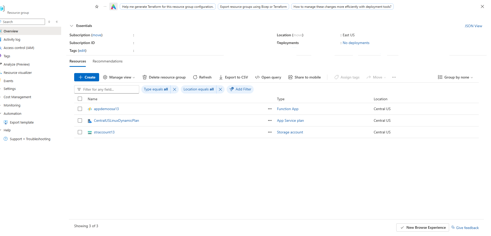

*Resource group inventory confirming successful deployment of Function App, Linux Dynamic Plan, and Storage Account.*

---

## 2. Step-by-Step Implementation

### Step 1: Create Virtual Environment and Provision Infrastructure

1. Created and activated a Python virtual environment (`.venv`) using `py -m venv .venv` in PowerShell.
2. Provisioned a supporting General Purpose V2 storage account (`straccount13`) using `az storage account create`.
3. Created the Linux Function App `appdemoosa13` with Python 3.10 runtime using `az functionapp create`.

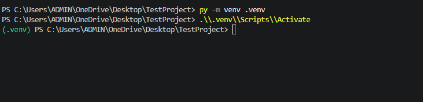

*PowerShell execution creating and activating local Python virtual environment .venv.*

---

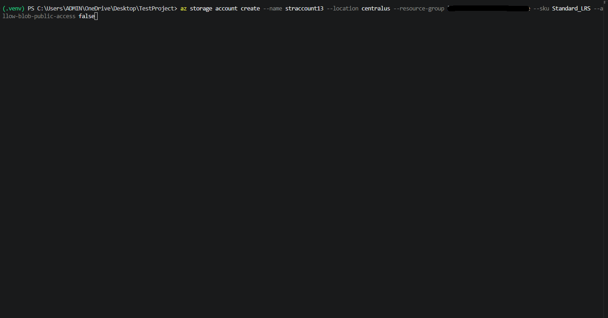

*Azure CLI command creating storage account straccount13 in Central US.*

---

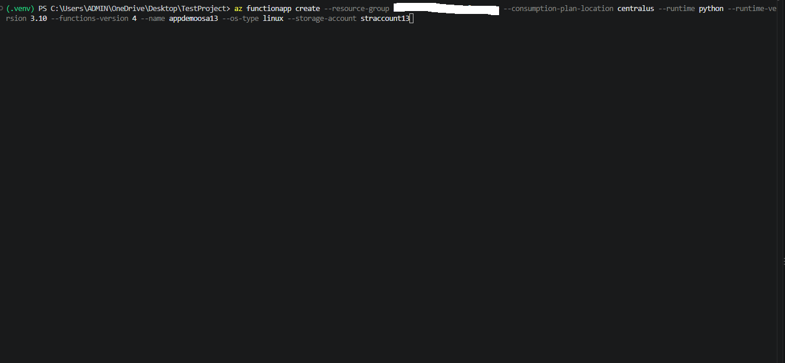

*Azure CLI command creating Linux Python Function App appdemoosa13 on Consumption plan.*

---

### Step 2: Initialize Local Function Project

1. Initialized a Python Function project using `func init --python`.
2. Created an HTTP trigger function named `HttpExample` with anonymous authorization using `func new`.

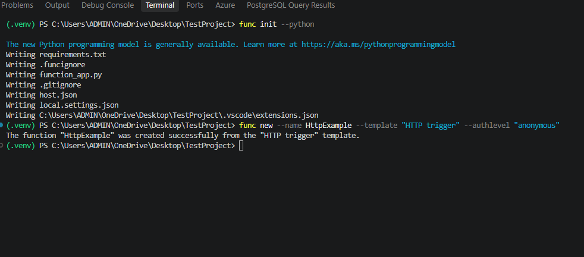

*Azure Functions Core Tools terminal output creating local Python function HttpExample.*

---

### Step 3: Test Function Locally

1. Started the local function runtime host using `func start`.
2. Verified local endpoint execution in a browser at `http://localhost:7071/api/HttpExample`.
3. Passed query parameter `?name=Osama` to verify personalized response payload.

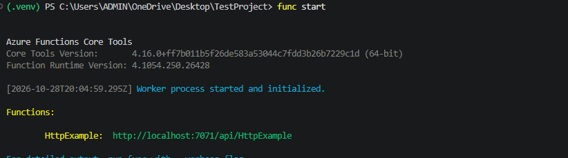

*Azure Functions Core Tools terminal initializing worker process and local URL http://localhost:7071/api/HttpExample.*

---

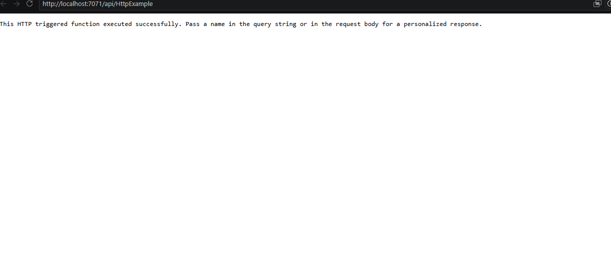

*Web browser displaying default response message from local HttpExample function endpoint.*

---

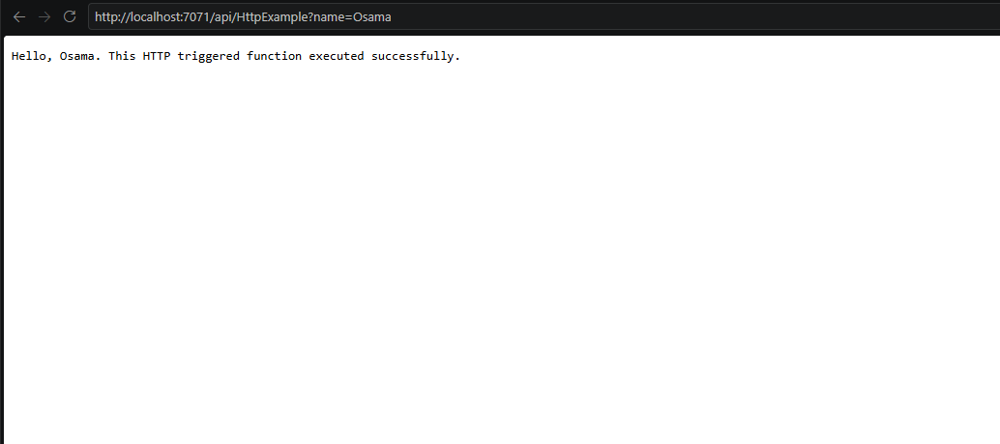

*Web browser displaying personalized greeting response passing name query parameter.*

---

### Step 4: Publish Function App to Azure

1. Deployed the local function code to Azure using `func azure functionapp publish appdemoosa13`.
2. Confirmed successful build, deployment, and trigger creation on the remote Linux host.

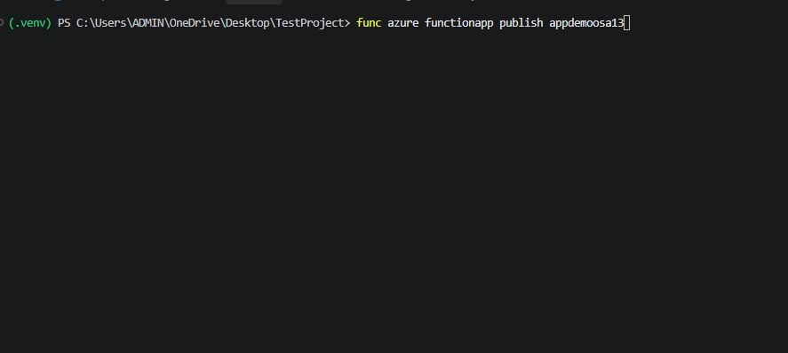

*Azure Functions Core Tools executing func azure functionapp publish to release appdemoosa13.*

---

## 3. Verification

### Step 1: Verify Default Endpoint Payload

1. Navigated to the production Function App URL (`https://appdemoosa13.azurewebsites.net/api/httpexample`).
2. Confirmed successful execution of the published Python function on Azure.

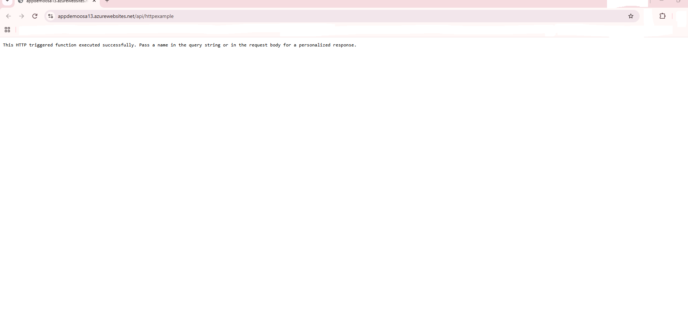

*Web browser confirming live response from published Azure Function endpoint.*

---

### Step 2: Verify Personalized Response Payload

1. Appended query string parameter `?name=Osama` to the production URL.
2. Confirmed personalized greeting payload returned from the live Azure Function.

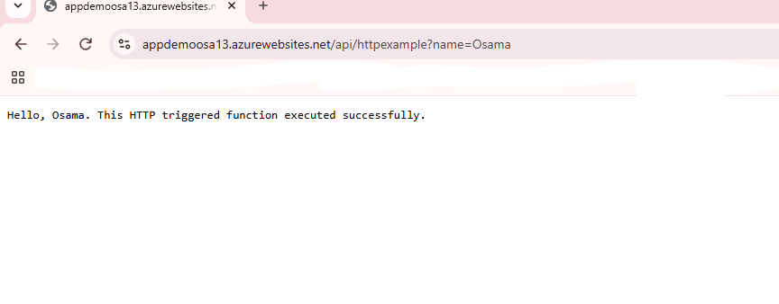

*Web browser confirming personalized greeting response from live published function appdemoosa13.*
